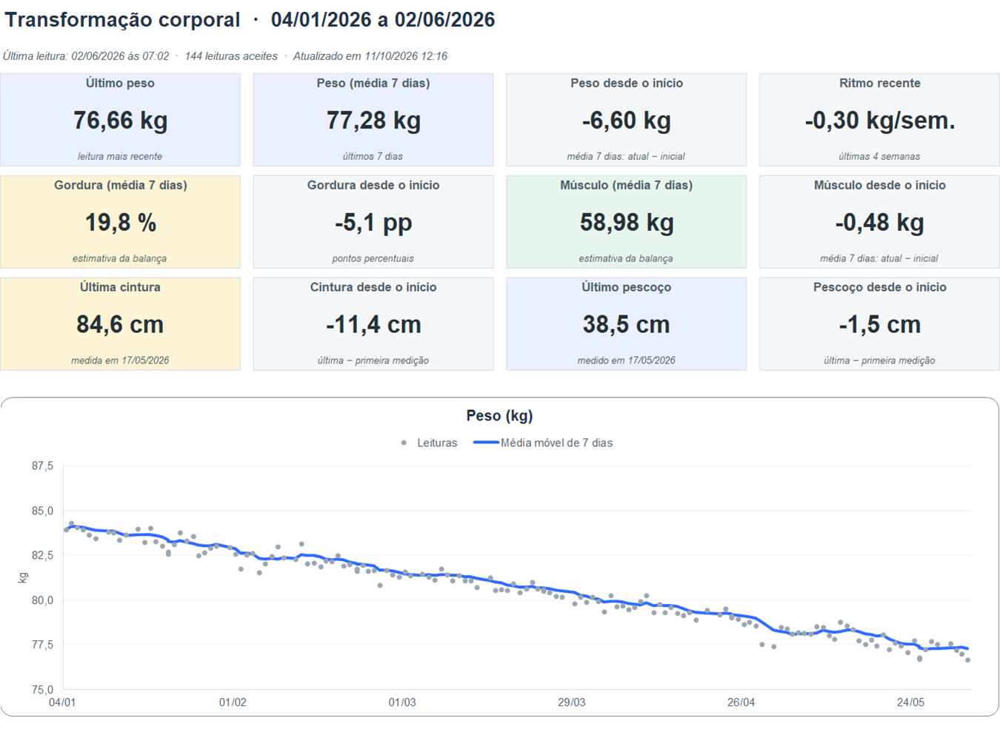
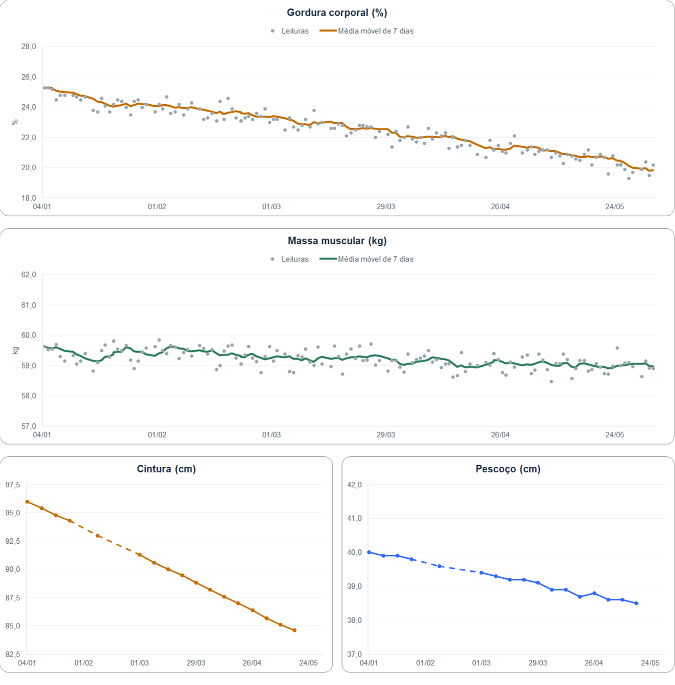
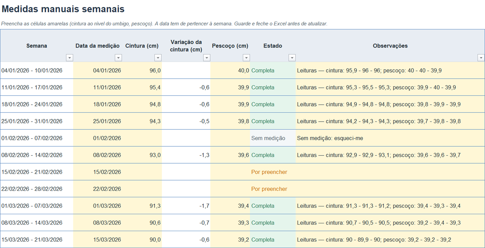
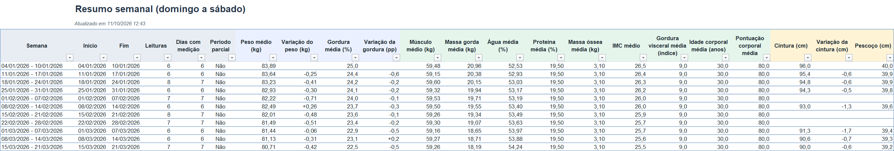
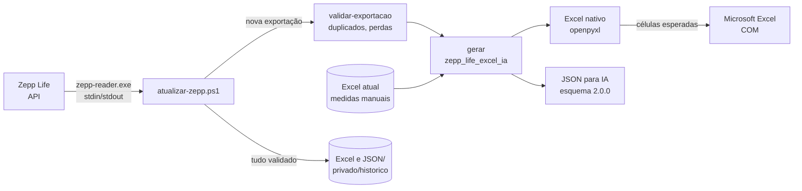

<div align="center">

# Zepp Life · Excel e IA

**Da balança Xiaomi para um Excel claro e um JSON pronto para IA — com um duplo clique.**

[](https://github.com/tpereira2005/zepp-life-excel-ia/actions/workflows/ci.yml)




<sub>Todas as imagens e exemplos usam <b>dados fictícios</b>.</sub>

</div>

---

## O que faz

Acompanha uma transformação corporal a partir das pesagens de uma **Xiaomi Mi Body Composition Scale 2** sincronizadas na **Zepp Life**, juntando-lhes medidas manuais semanais de **cintura** e **pescoço**.

| | |
|---|---|
| 📥 **Descarrega** | Todas as pesagens da conta Zepp Life (sessão reutilizada; credenciais cifradas com DPAPI do Windows). |
| 🧹 **Seleciona** | Só leituras completas do perfil titular, desde a data de início; exclusões ficam listadas com o motivo. |
| 📊 **Excel nativo** | Painel com indicadores, gráficos com média móvel de 7 dias, resumos semanais e mensais, medidas manuais editáveis. |
| 🤖 **JSON para IA** | Esquema estável e versionado ([`schema/`](schema/dados-zepp-life-ia.schema.json)), datas ISO com UTC, unidades, dicionário de métricas e convenções explícitas. |
| 🛡️ **Seguro** | Recusa descargas incompletas, prepara tudo numa pasta temporária, confirma cada valor no **Microsoft Excel real** e só depois substitui; as versões anteriores ficam em `privado\historico\`. |

<table>
<tr>
<td width="50%"></td>
<td width="50%"><br><br></td>
</tr>
</table>

## Início rápido

> Requisitos: Windows 10/11, [Python 3.11+](https://www.python.org/downloads/) e Microsoft Excel (recomendado, para validar e consultar).

```bat
git clone https://github.com/tpereira2005/zepp-life-excel-ia.git
cd zepp-life-excel-ia
INSTALAR.cmd
```

1. Edite `config.json` (data de início, protocolo de pesagem, CSV inicial opcional).
2. Coloque o leitor `zepp-reader.exe` em `bin\` — descarregue-o dos artefactos do [CI](https://github.com/tpereira2005/zepp-life-excel-ia/actions/workflows/ci.yml) ou compile-o (ver [instalação](docs/INSTALACAO.md)).
3. Sincronize a balança na Zepp Life, feche o Excel e execute **`ATUALIZAR-EXCEL.cmd`**.

Para experimentar sem conta, abra o [exemplo fictício](docs/exemplo/) (Excel, JSON, exportação e CSV de medidas).

## Utilização diária

| Comando | Quando usar |
|---|---|
| `ATUALIZAR-EXCEL.cmd` | Depois de novas pesagens: descarrega, valida e atualiza o Excel e o JSON. |
| `RECALCULAR-SEM-DESCARREGAR.cmd` | Depois de editar medidas manuais no Excel: regenera sem contactar a Xiaomi. |
| `ESQUECER-CONTA.cmd` | Apaga a conta e a sessão guardadas neste computador (por exemplo, após mudar a palavra-passe). |

Se apagou pesagens de propósito na Zepp Life, a proteção contra perdas interrompe a atualização; nesse caso use `scripts\atualizar-zepp.ps1 -PermitirRemocoes`. Mais detalhes em [docs/UTILIZACAO.md](docs/UTILIZACAO.md).

### Onde ficam os ficheiros

```
zepp-life-excel-ia\
├─ ATUALIZAR-EXCEL.cmd · RECALCULAR-SEM-DESCARREGAR.cmd · ESQUECER-CONTA.cmd · INSTALAR.cmd
├─ Excel e JSON\          ← o que se abre: analise-historico-zepp-life.xlsx e dados-zepp-life-ia.json
├─ privado\               entradas, última exportação, histórico, temporários, backups e notas
├─ config.json            configuração pessoal (copiada de config.example.json)
└─ bin\zepp-reader.exe    leitor da Zepp Life
```

`Excel e JSON\`, `privado\`, `config.json` e `bin\` são pessoais e nunca vão para o Git.

## Regras dos dados

- **Leituras aceites:** perfil titular, data local ≥ início, composição corporal completa e valores plausíveis.
- **Semanas** de domingo a sábado em `Europe/Lisbon`; **médias** por leitura; **dias com medição** mostram quantos dias contribuíram.
- **Variações** entre períodos consecutivos; gordura em pontos percentuais; cintura face à medição anterior disponível.
- **Última leitura** pelo instante UTC, para não haver ambiguidade na mudança de hora.
- **Ausências são `null`**, nunca zero. Os tracejados dos gráficos são só visuais — nenhum valor é inventado.

Tudo explicado em [docs/DADOS-E-REGRAS.md](docs/DADOS-E-REGRAS.md) e [docs/JSON-PARA-IA.md](docs/JSON-PARA-IA.md).

## Arquitetura



Os cálculos são feitos uma única vez em Python. O Excel recebe fórmulas nativas (para refletir edições manuais) e cada folha regista o valor que o Python espera nas células com fórmulas; o Excel real confirma-os antes de qualquer ficheiro ser substituído. Ver [docs/ARQUITETURA.md](docs/ARQUITETURA.md).

## Privacidade

Os dados corporais são pessoais. O repositório **não contém** dados reais: `config.json`, `Excel e JSON/` e `privado/` estão no `.gitignore`. Conta e sessão ficam fora do projeto, em `%LOCALAPPDATA%\ZeppLifeExcel`, cifradas com DPAPI e acessíveis apenas ao utilizador Windows. O JSON não inclui credenciais, tokens, email nem o identificador do dispositivo.

## Desenvolvimento

```
zepp_life_excel_ia\
├─ __main__.py      linha de comandos: gerar | validar-exportacao
├─ gerar.py         gerar(): lê, calcula, escreve o Excel, verifica no Excel real, escreve o JSON
├─ metricas.py      registo único das métricas (JSON, colunas do Excel, resumos, limites)
├─ exportacao.py    validação de uma nova descarga
├─ leituras.py      fuso horário, seleção e motivos de exclusão
├─ medidas.py       medidas manuais (leitura pelo cabeçalho, CSV inicial, prioridades)
├─ resumos.py       cálculos: períodos, médias móveis, indicadores (fonte única)
├─ excel\           um módulo por folha + estilos e gráficos
├─ verificacao.py   corre o Excel real e compara as células esperadas
└─ ia_json.py       JSON para IA
```

```bat
.venv\Scripts\python -m zepp_life_excel_ia gerar --origem exportacao.json --excel livro.xlsx --json dados.json [--existente atual.xlsx] [--sem-excel-real]
.venv\Scripts\python -m zepp_life_excel_ia validar-exportacao --nova nova.json --anterior anterior.json
```

**Acrescentar uma métrica:** declare-a em `metricas.py` (chave JSON, unidade, coluna e formato no Excel, nome no resumo) e inclua-a em `COLUNAS_MEDICOES` e/ou `RESUMO`. O Excel, o JSON e a verificação passam a usá-la; atualize o [esquema JSON](schema/dados-zepp-life-ia.schema.json).

### Testes

```bat
.venv\Scripts\python -m pip install -r requirements-dev.txt
.venv\Scripts\python -m ruff check .
.venv\Scripts\python -m pytest
powershell -NoProfile -ExecutionPolicy Bypass -File tests\atualizador.Tests.ps1
```

Os testes usam apenas dados fictícios. Com o Excel instalado, um dos testes abre o livro no Excel real e confirma todas as células esperadas; o atualizador é testado com um leitor simulado e pastas temporárias. O CI corre os testes Python em Windows e Linux, os do atualizador em Windows, o ruff, e compila o leitor Go.

### Documentação

| | |
|---|---|
| [INSTALACAO.md](docs/INSTALACAO.md) | Instalação, configuração, leitor e primeira autenticação |
| [UTILIZACAO.md](docs/UTILIZACAO.md) | Atualizações, medidas manuais e folhas do Excel |
| [DADOS-E-REGRAS.md](docs/DADOS-E-REGRAS.md) | Seleção das leituras, agregações e gráficos |
| [JSON-PARA-IA.md](docs/JSON-PARA-IA.md) | Estrutura e convenções do JSON 2.0.0 |
| [ARQUITETURA.md](docs/ARQUITETURA.md) | Módulos, fluxo da atualização e decisões |
| [RELATORIO-REVISAO.md](docs/RELATORIO-REVISAO.md) | O que mudou nas revisões e como foi verificado |
| [CHANGELOG.md](CHANGELOG.md) | Registo de versões |

## Créditos

O leitor em [`leitor/`](leitor/) deriva de [SmartScaleConnect](https://github.com/AlexxIT/SmartScaleConnect) de Alexey Khit (MIT), adaptado para uma exportação só de leitura com segredos por stdin. Este projeto não é afiliado à Xiaomi nem à Zepp Health.

<sub>As estimativas de composição corporal são da aplicação e não constituem diagnóstico clínico.</sub>
